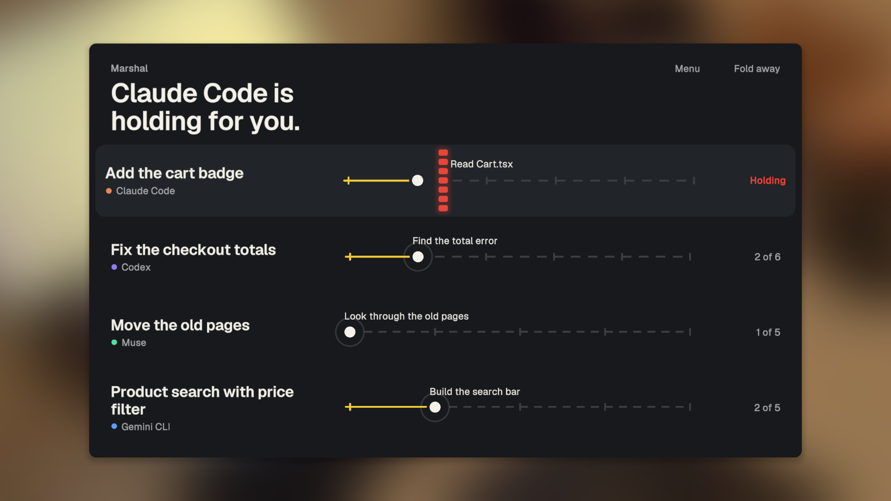

# Marshal

Direct your coding agents with your hands.

Marshal is a mixed reality app for Meta Quest 3 that shows every coding agent on your PC (Claude Code, Codex CLI, Gemini CLI, Meta Muse) in one window beside your monitor. When an agent asks for permission, you answer with your hands: a short pinch for a harmless request, both hands held for a dangerous one, both palms forward to stop every agent at once.



- Video (1:43, recorded on the headset): https://youtu.be/-FGZNN-aKpE
- Devpost: https://devpost.com/software/marshal-p3o0dj
- Headset app: the "Competition" release channel, https://www.meta.com/s/5FzKfTWZQ

## How it fits together

```
 coding agent ──hook──▶ bridge on your PC ──ws:// on your LAN──▶ Marshal on the Quest
 (Claude Code,          127.0.0.1:47820       port 47821          approve / deny / stop
  Codex, Gemini, Muse)  risk classifier,
                        impact analysis, halt
```

The headset never talks to an agent directly. The bridge receives each agent's hook events, rates every permission request with a deterministic classifier (no AI), and holds the request until the headset answers. Without a headset decision, Claude Code, Codex and Gemini show their own prompt as usual.

## Get started

You need a Meta Quest 3 and, for your own agents, a PC with Node.js 22.12 or newer on the same network.

1. **On the headset:** install Marshal from the release channel above. "Take the tour" works right away, without a PC: a recorded session teaches each gesture by letting you do it.
2. **On the PC:** run one command.

   ```
   npx marshal-agents
   ```

   It finds the agents on this computer (Claude Code, Codex CLI, Gemini CLI, Muse), shows exactly which file it changes for each, asks once, and starts the bridge. Your browser opens a local status page with the pairing QR code.
3. **Look at the QR code** with the headset open in Marshal, or choose "Connect to my PC" and type the 6-digit code. Done: your agents appear as lines in the window, and their permission requests wait for your hands.

Next time, `npx marshal-agents start` starts the bridge again. `npx marshal-agents disconnect` removes everything Marshal added. Details: [docs/setup.md](docs/setup.md).

### Or use your agent's plugin system

[`plugins/marshal/`](plugins/marshal/) is the Claude Code plugin; [`plugins/marshal-agents/`](plugins/marshal-agents/) is the same bridge for Muse and Codex, which read [`.agents/plugins/marketplace.json`](.agents/plugins/marketplace.json). Use either the plugin or `npx marshal-agents` for an agent, not both.

| Agent | Install | Status |
|---|---|---|
| Claude Code (CLI, IDEs, Claude desktop app) | `/plugin marketplace add lb2002/marshal`, then `/plugin install marshal@marshal`; "connect Marshal" starts the bridge | tested with a simulated headset |
| Muse 1.4.15+ | `muse plugins marketplace add marshal https://github.com/lb2002/marshal`, `muse plugins install marshal@marshal`, `muse plugins approve marshal` | installed and hook run checked with Muse itself |
| Codex | `codex plugin marketplace add lb2002/marshal`, `codex plugin add marshal@marshal`, trust the hooks in `/hooks` | installs; not tried in a live session |
| Gemini CLI | `gemini extensions install https://github.com/lb2002/marshal` | experimental, not tried live |
| OpenCode | `npx marshal-agents` sets up a local OpenCode plugin | experimental, not tried live |

## What is in this repository

| Folder | What it is |
|---|---|
| [`bridge/`](bridge/) | The PC bridge (Node.js, TypeScript, one dependency: `ws`). CLI, hooks for four agents, risk classifier, impact analysis, halt, pairing. Full reference in [`bridge/README.md`](bridge/README.md). |
| [`quest/`](quest/) | The headset app (Unity 6000.6, OpenXR, Meta XR SDK 209: hand tracking, passthrough, spatial anchors, MR Utility Kit). |
| [`plugins/`](plugins/) | The Claude Code plugin (`marshal`) and the Muse/Codex plugin (`marshal-agents`), generated from the bridge by [`scripts/build-plugins.mjs`](scripts/build-plugins.mjs). |
| [`demo/`](demo/) | The anonymised recorded session behind the tour and the demo. |
| [`docs/`](docs/) | Setup, design renders, research notes on the hook formats of the four agents. |

## Safety model, in short

- **The effort grows with the risk.** One hand for harmless requests, both hands for 1.5 seconds for destructive ones (deleting, forced pushes, writes outside the project, any call of Marshal's own CLI, writes to the agents' settings folders).
- **Approve what you see.** The headset shows the exact command. Any visible change to a request cancels a hold in progress. Commands are classified with a quote-aware shell lexer for bash and PowerShell; on Windows, commands from Codex, Gemini and Muse get both rule sets and the worse one counts.
- **It never claims that something is safe.** The impact analysis only states losses it is sure of ("Gone, no way back").
- **The halt is a brake, not a sandbox.** Both palms deny every open request and make each agent stop before its next tool call; the app says which agents it can truly stop.
- **Local only.** Hooks talk to `127.0.0.1`; the headset pairs over your LAN with a single-use 6-digit code that expires after 5 minutes. The link is unencrypted `ws://`: use it only on a network you trust. The threat model is a single-user development machine.

## Tests

```
cd bridge && npm test
```

About 2,170 tests for the bridge (on Windows; Linux and macOS are not checked yet) and about 1,100 Unity tests (EditMode and PlayMode) for the headset app (`quest/Assets/Lotse/Tests`, `quest/Assets/Lotse/App/Tests`).

## Names

The product is called Marshal. It started as "Lotse" (German for a ship's pilot), and the code still uses that name: the CLI, the `~/.lotse` folder, the `LOTSE_*` variables and the Unity namespaces.

## Licence

Apache License 2.0, see [LICENSE](LICENSE). Copyright 2026 Linus Baumberger.

The Geist typeface in `quest/Assets/Lotse/Fonts/Geist` is under the SIL Open Font License (`OFL.txt` next to it). TextMesh Pro and Liberation Sans come with Unity under their own licences.
